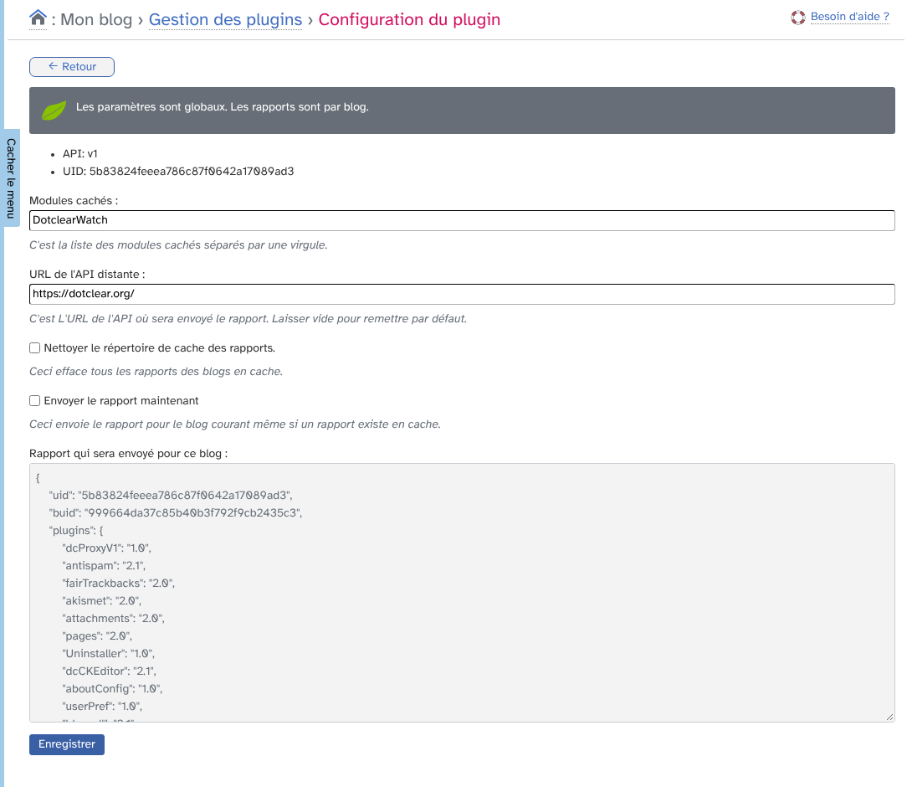

# Dotclear Watch : guide d'utilisation

Dotclear Watch envoie régulièrement un petit rapport anonyme sur votre installation de Dotclear à un serveur de statistiques. Le serveur par défaut est [stat.dotclear.watch](https://stat.dotclear.watch). Cela permet de savoir quelles versions de Dotclear, de PHP et quels plugins sont utilisés.

Ce plugin n'a pas de page d'administration. Il se règle dans sa page de configuration, dans le gestionnaire de plugins.

## Sommaire

1. [Ce qui est envoyé](#ce-qui-est-envoyé)
2. [Quand le rapport part](#quand-le-rapport-part)
3. [Ouvrir la configuration](#ouvrir-la-configuration)
4. [Cacher des modules](#cacher-des-modules)
5. [Changer le serveur](#changer-le-serveur)
6. [Voir le rapport](#voir-le-rapport)
7. [Envoyer le rapport tout de suite](#envoyer-le-rapport-tout-de-suite)
8. [Vider le cache des rapports](#vider-le-cache-des-rapports)
9. [Arrêter l'envoi](#arrêter-lenvoi)
10. [Bon à savoir](#bon-à-savoir)

## Ce qui est envoyé

Le rapport ne contient ni nom de blog, ni adresse, ni identifiant d'utilisateur. Il contient :

* un numéro d'installation (UID) généré au hasard, et un numéro propre au blog ;
* la liste des plugins et des thèmes **activés**, avec leur version ;
* la langue et le thème du blog ;
* le nombre de blogs de l'installation ;
* la version de Dotclear ;
* le logiciel serveur, la version de PHP et le système ;
* le type et la version de la base de données.

Le rapport est affiché en entier dans la page de configuration : vous voyez exactement ce qui part.

## Quand le rapport part

L'envoi est automatique : il se déclenche quand vous ouvrez le tableau de bord de l'administration. Un rapport n'est envoyé qu'**une fois par semaine** et par blog. Si l'envoi échoue, il est retenté au bout d'un jour.

Un lien **Statistiques partagées** est affiché en bas de chaque page de l'administration : il mène au site des statistiques. Il n'apparaît que si les rapports partent vers le serveur par défaut.

## Ouvrir la configuration

Allez dans **Système > Gestion des plugins**, trouvez **Dotclear Watch** dans la liste et cliquez sur **Configurer**.

La page commence par rappeler que les réglages sont globaux (pour toute l'installation) et que les rapports sont par blog. Elle affiche aussi la version de l'API et l'UID de votre installation.

## Cacher des modules

Par défaut, tous les plugins et thèmes activés sont listés, sauf Dotclear Watch lui-même. Pour en cacher d'autres, écrivez leurs identifiants dans **Modules cachés**, séparés par une virgule : par exemple `aboutConfig, monPlugin`.

Cliquez sur **Enregistrer**. Les modules cachés disparaissent du rapport.

L'identifiant d'un module est celui qui est affiché entre parenthèses dans le gestionnaire de plugins ou de thèmes.

## Changer le serveur

**URL de l'API distante** contient l'adresse du serveur qui reçoit les rapports. Par défaut : `https://dotclear.watch/api`. Vous pouvez la remplacer par un serveur à vous. Laissez le champ vide puis enregistrez pour revenir à l'adresse par défaut.

## Voir le rapport

Le cadre **Rapport qui sera envoyé pour ce blog** montre le contenu exact, au format JSON. Il est en lecture seule.

## Envoyer le rapport tout de suite

Cochez **Envoyer le rapport maintenant** puis cliquez sur **Enregistrer**. Le rapport du blog courant est envoyé même si un rapport récent existe.

Un message confirme le résultat :

Si le serveur ne répond pas, un message d'avertissement donne la raison de l'échec :

Les réglages saisis dans la page sont enregistrés dans tous les cas.

## Vider le cache des rapports

Le dernier rapport de chaque blog est gardé dans les journaux de Dotclear. Cochez **Nettoyer le répertoire de cache des rapports** puis **Enregistrer** pour tout effacer. Le prochain passage sur le tableau de bord enverra un nouveau rapport.

## Arrêter l'envoi

Pour ne plus rien envoyer, désactivez ou désinstallez le plugin dans le gestionnaire de plugins. Désinstaller supprime aussi ses réglages.

## Bon à savoir

* **Changer l'URL et envoyer dans la même validation** : le rapport part tout de suite vers la nouvelle adresse.
* **Un serveur injoignable** : les envois automatiques échouent sans message sur le tableau de bord. La page de configuration affiche « Le dernier envoi a échoué : … » avec la raison de l'échec.
* **Le rapport automatique** dépend du tableau de bord : un blog dont l'administration n'est jamais ouverte n'envoie rien.
