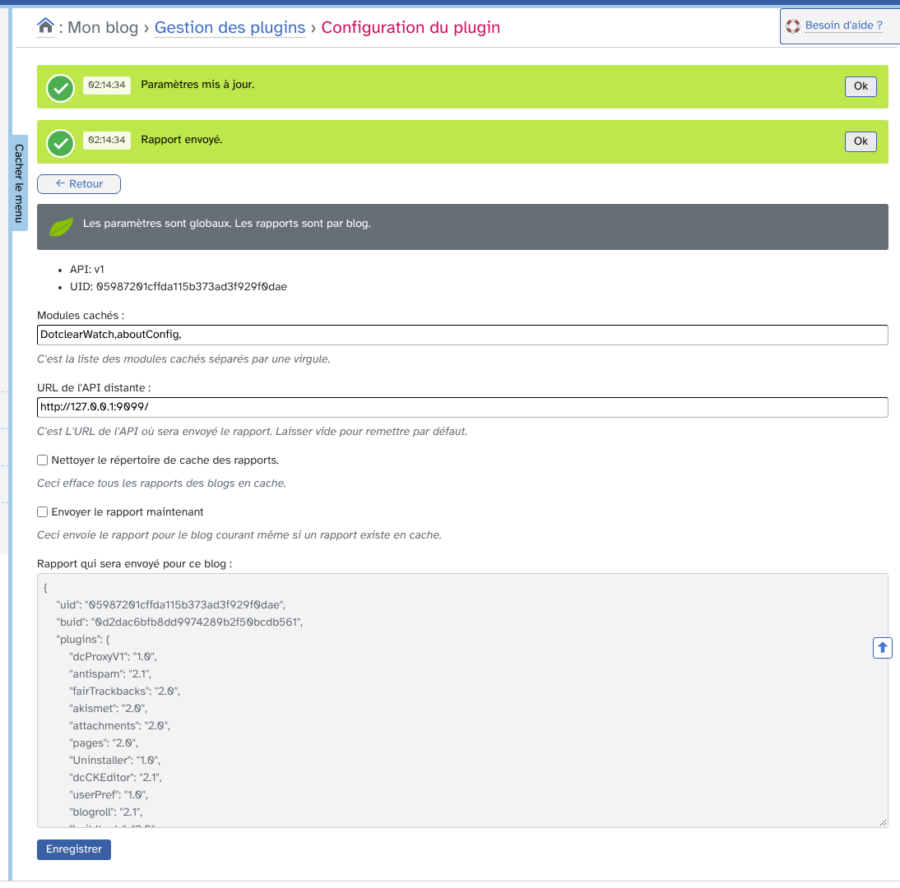
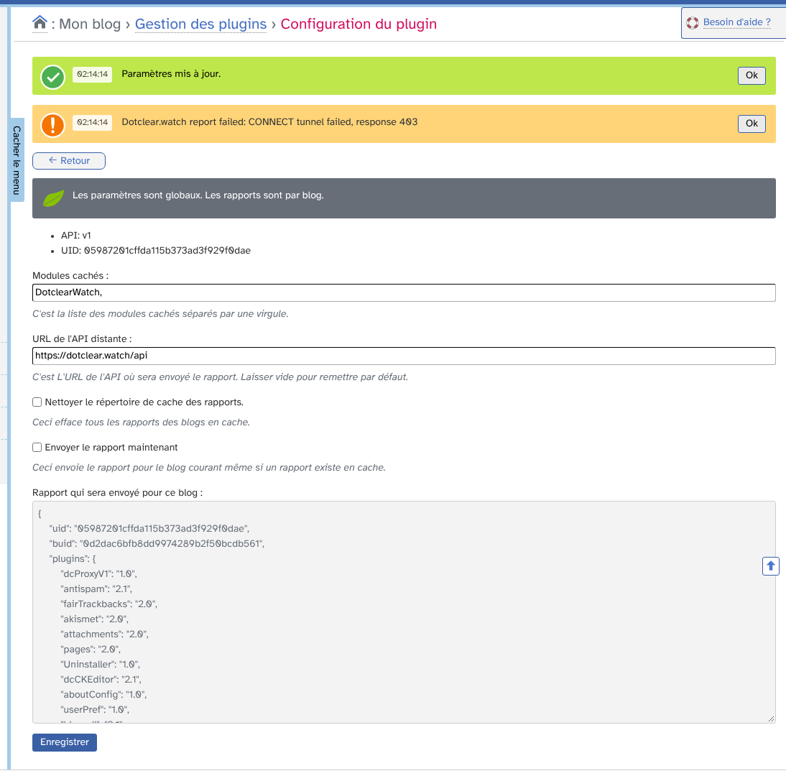
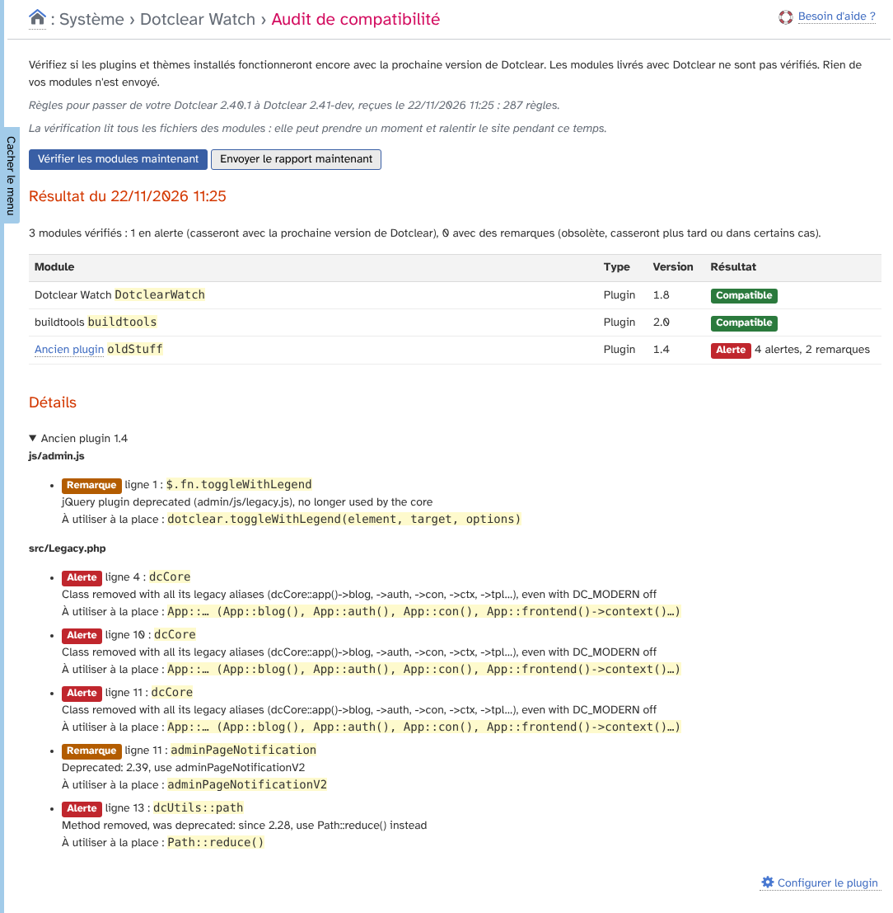
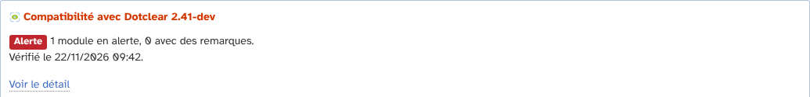

# Dotclear Watch : guide d'utilisation

Dotclear Watch envoie régulièrement un petit rapport anonyme sur votre installation de Dotclear à un serveur de statistiques. Le serveur par défaut est celui du site officiel, avec ses [statistiques](https://dotclear.org/statistics). Cela permet de savoir quelles versions de Dotclear, de PHP et quels plugins sont utilisés.

Il se règle dans sa page de configuration, dans le gestionnaire de plugins. Sa page d'administration, réservée au super administrateur, vérifie si vos plugins et thèmes fonctionneront encore avec la prochaine version de Dotclear (audit de compatibilité).

## Sommaire

1. [Ce qui est envoyé](#ce-qui-est-envoyé)
2. [Quand le rapport part](#quand-le-rapport-part)
3. [Ouvrir la configuration](#ouvrir-la-configuration)
4. [Cacher des modules](#cacher-des-modules)
5. [Changer le serveur](#changer-le-serveur)
6. [Voir le rapport](#voir-le-rapport)
7. [Envoyer le rapport tout de suite](#envoyer-le-rapport-tout-de-suite)
8. [Vider le cache des rapports](#vider-le-cache-des-rapports)
9. [Audit de compatibilité](#audit-de-compatibilité)
10. [Arrêter l'envoi](#arrêter-lenvoi)
11. [Bon à savoir](#bon-à-savoir)

## Ce qui est envoyé

Le rapport ne contient ni nom de blog, ni adresse, ni identifiant d'utilisateur. Il contient :

* un numéro d'installation (UID) généré au hasard, et un numéro propre au blog ;
* la liste des plugins et des thèmes **activés**, avec leur version ;
* la liste des plugins installés mais **désactivés** (par vous ou par Dotclear, faute de dépendance), avec leur version ;
* la langue et le thème du blog ;
* le nombre de blogs de l'installation ;
* la version de Dotclear, et si l'option `DC_MODERN` (code ancien et obsolète non chargé) est active dans `inc/config.php` ;
* le logiciel serveur, la version de PHP, les extensions PHP chargées (avec leur version) et le système ;
* le type et la version de la base de données.

Le rapport est affiché en entier dans la page de configuration : vous voyez exactement ce qui part.

## Quand le rapport part

L'envoi est automatique : il se déclenche quand vous ouvrez le tableau de bord de l'administration. Un rapport n'est envoyé qu'**une fois par semaine** et par blog. Si l'envoi échoue, il est retenté au bout d'un jour.

Un lien **Statistiques partagées** est affiché en bas de chaque page de l'administration : il mène au site des statistiques. Il n'apparaît que si les rapports partent vers le serveur par défaut.

## Ouvrir la configuration

Allez dans **Système > Gestion des plugins**, trouvez **Dotclear Watch** dans la liste et cliquez sur **Configurer**.

La page commence par rappeler que les réglages sont globaux (pour toute l'installation) et que les rapports sont par blog. Elle affiche aussi la version de l'API et l'UID de votre installation.

## Cacher des modules

Par défaut, tous les plugins (activés ou non) et thèmes activés sont listés, sauf Dotclear Watch lui-même. Pour en cacher d'autres, écrivez leurs identifiants dans **Modules cachés**, séparés par une virgule : par exemple `aboutConfig, monPlugin`.

Cliquez sur **Enregistrer**. Les modules cachés disparaissent du rapport, qu'ils soient activés ou désactivés.

L'identifiant d'un module est celui qui est affiché entre parenthèses dans le gestionnaire de plugins ou de thèmes.

## Changer le serveur

**URL de l'API distante** contient l'adresse du serveur qui reçoit les rapports. Par défaut : `https://dotclear.org/`. Vous pouvez la remplacer par un serveur à vous. Depuis la version 1.7, l'ancienne adresse par défaut (`https://dotclear.watch/api`) est remplacée automatiquement à la mise à jour ; une adresse personnalisée est conservée. Laissez le champ vide puis enregistrez pour revenir à l'adresse par défaut.

## Voir le rapport

Le cadre **Rapport qui sera envoyé pour ce blog** montre le contenu exact, au format JSON. Il est en lecture seule.

## Envoyer le rapport tout de suite

Cochez **Envoyer le rapport maintenant** puis cliquez sur **Enregistrer**. Le rapport du blog courant est envoyé même si un rapport récent existe.

Un message confirme le résultat :

Si le serveur ne répond pas, un message d'avertissement donne la raison de l'échec :

Les réglages saisis dans la page sont enregistrés dans tous les cas.

## Vider le cache des rapports

Le dernier rapport de chaque blog est gardé dans les journaux de Dotclear. Cochez **Nettoyer le répertoire de cache des rapports** puis **Enregistrer** pour tout effacer. Le prochain passage sur le tableau de bord enverra un nouveau rapport.

## Audit de compatibilité

En réponse au rapport, le serveur envoie les **règles de compatibilité** de la prochaine version de Dotclear : ce qui va disparaître ou changer dans le code de Dotclear. Avec ces règles, Dotclear Watch peut lire le code de vos plugins et thèmes, sur votre serveur, et vous dire lesquels risquent de casser. Le code de vos modules n'est jamais envoyé.

Ouvrez **Système > Dotclear Watch** (super administrateur seulement).

### Recevoir les règles

Les règles arrivent avec le rapport hebdomadaire. Tant qu'elles ne sont pas arrivées, la page le dit : cliquez sur **Envoyer le rapport maintenant** pour les recevoir tout de suite. La page indique ensuite la version de Dotclear visée, la date de réception et le nombre de règles.

Si la prochaine version de Dotclear demande une version de PHP plus récente que celle de votre serveur, un avertissement l'indique en haut de la page et sur le tableau de bord.

### Vérifier les modules

Cliquez sur **Vérifier les modules maintenant**. La vérification lit tous les fichiers des plugins et thèmes installés : elle peut prendre un moment. Elle ne se lance jamais toute seule, pour ne pas ralentir votre site. Les modules livrés avec Dotclear ne sont pas vérifiés : ils sont mis à jour avec Dotclear.

### Lire le résultat

Chaque module a un résultat :

* **Alerte** (rouge) : le module cassera avec la prochaine version de Dotclear ;
* **Remarque** (orange) : le module utilise quelque chose d'obsolète ; il cassera plus tard, ou dans certains cas ;
* **Compatible** (vert) : rien n'a été trouvé.

Le bouton ▶ devant un module en alerte ou avec des remarques déplie son **détail** sous sa ligne (celui des modules en alerte est déjà déplié, et le bouton de l'en-tête du tableau déplie ou replie tout) : pour chaque fichier, la ligne, l'élément concerné, une explication (en anglais) et ce qu'il faut utiliser à la place. La mention « prévu pour Dotclear 2.45 » signale une règle de prévision, pour une version plus lointaine que la prochaine : elle compte comme une remarque jusqu'à ce que cette version devienne la prochaine. La mention « probable » signale un élément reconnu à son seul nom ; « le module le gère peut-être déjà » signale un fichier qui vérifie déjà la version de Dotclear : l'alerte devient alors une remarque.

Quand les règles, vos modules ou Dotclear changent, le résultat est marqué **à refaire** : relancez la vérification.

### Sur le tableau de bord

Une fois les règles reçues, le tableau de bord du super administrateur affiche un résumé : nombre de modules en alerte et avec des remarques, date de la vérification, et un lien vers le détail.

Pour masquer ce résumé, décochez **Afficher l’audit de compatibilité des modules sur le tableau de bord** dans **Mes préférences** › **Mon tableau de bord**, puis enregistrez. L'option n'apparaît que pour les super administrateurs.

La vérification est une aide, pas une garantie : certains usages ne se voient pas en lisant le code. Pour un module en alerte, cherchez une nouvelle version ou prévenez son auteur.

## Arrêter l'envoi

Pour ne plus rien envoyer, désactivez ou désinstallez le plugin dans le gestionnaire de plugins. Désinstaller supprime aussi ses réglages, les règles reçues et le résultat de l'audit.

## Bon à savoir

* **Changer l'URL et envoyer dans la même validation** : le rapport part tout de suite vers la nouvelle adresse.
* **Un serveur injoignable** : les envois automatiques échouent sans message sur le tableau de bord. La page de configuration affiche « Le dernier envoi a échoué : … » avec la raison de l'échec.
* **Le rapport automatique** dépend du tableau de bord : un blog dont l'administration n'est jamais ouverte n'envoie rien.
